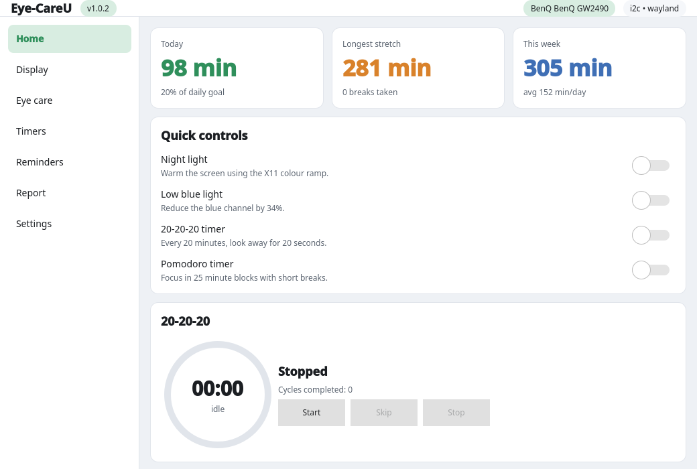
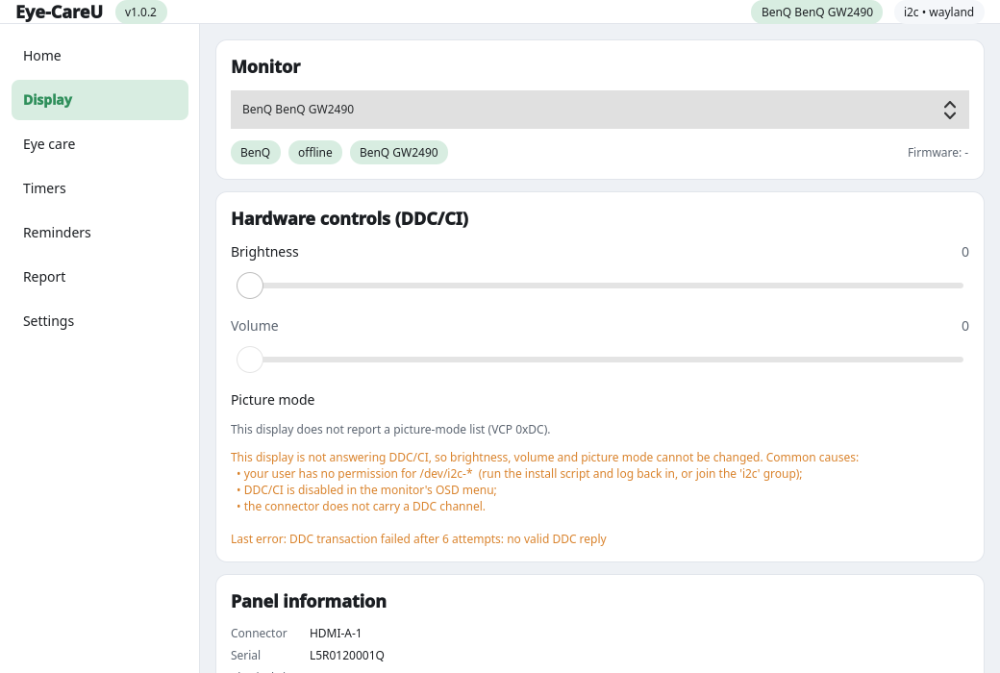
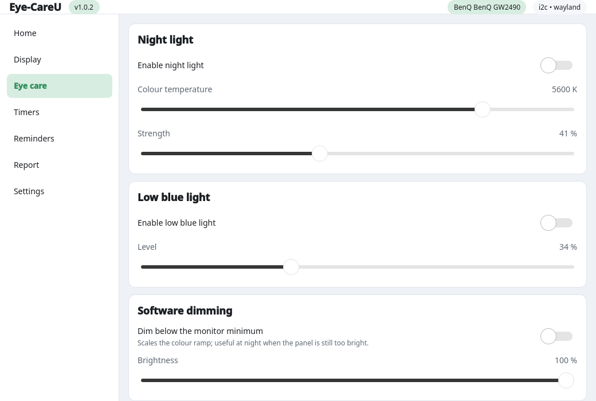
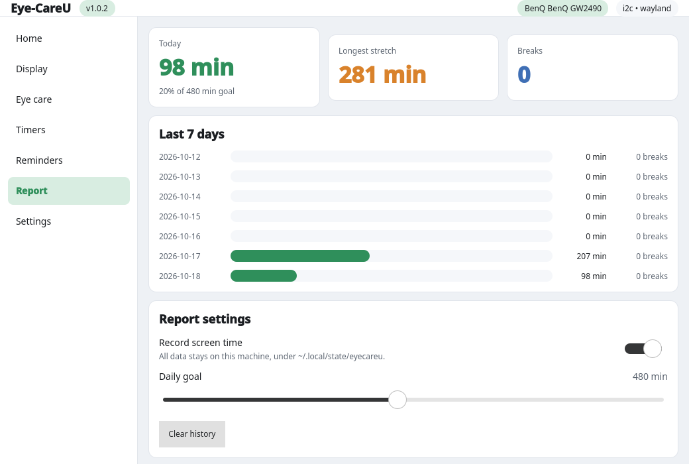

# Eye-CareU for Linux

[](https://github.com/enn-dee/eyecareu-linux/releases/latest)
[](https://github.com/enn-dee/eyecareu-linux/actions/workflows/ci.yml)
[](LICENSE)
[](pyproject.toml)
[](#session-support)

A native Linux port of **BenQ Eye-CareU** (Windows v1.5.5.0), rebuilt for
Fedora and other modern distributions. It talks to BenQ and other DDC/CI
monitors over the standard Linux `i2c-dev` interface, and it reimplements the
Windows application's software eye-care features (timers, reminders, colour
temperature, screen-time report) as first-class Linux functionality.

* **Stack:** Python 3.10+ with PySide6 (Qt 6 / QML).
* **Sessions:** X11 and Wayland (see [Session support](#session-support)).
* **Dependencies:** `PySide6` plus optional `ddcutil`, `i2c-tools`, `xrandr`,
  `xprintidle` from the distribution.



| Display (DDC/CI) | Eye care | Screen-time report |
| --- | --- | --- |
|  |  |  |

*Real renders of the Qt/QML UI — more in [`docs/screenshots/`](docs/screenshots/).*

## Quick start

```bash
git clone https://github.com/enn-dee/eyecareu-linux
cd eyecareu-linux
./install-fedora.sh                    # Fedora & derivatives, per-user install
# ./install-fedora.sh --system         # ...or system-wide (needs sudo)
```

Arch Linux — build the bundled PKGBUILD:

```bash
cd packaging/aur && makepkg -si
```

Any other distribution, or straight from source:

```bash
python3 -m pip install --user .
sudo install -m 0644 packaging/99-eyecareu-i2c.rules /etc/udev/rules.d/
sudo udevadm control --reload-rules && sudo udevadm trigger
```

Then:

```bash
eyecareu               # window
eyecareu --tray        # start in the system tray
eyecareu --doctor      # diagnose session, groups, colour backend and monitors
```

> After the udev rule is installed, **log out and back in** (or run
> `newgrp i2c`) so your user joins the `i2c` group. The app also re-execs
> through `sg` on first run, so hardware control normally works immediately.

---

## What was reverse engineered

Everything below was recovered from the shipped Windows installer
(`Eye-CareU for Win_V1.5.5.0_Windows_260811170539.zip`) by extracting the Inno
Setup payload and analysing the PE32+ binaries with REA plus `objdump` PE/PDB
parsing. Observed facts are separated from convention throughout the code.

### Binaries

| Binary | Role |
| --- | --- |
| `Eye-CareU.exe` | Qt 6 / QML application (QML is compiled in; 43 embedded `<VCPTree>` capability schemas). Build path leaked: `D:/01_program/EyeCare/setup/win64/build/bin`. |
| `EcShared.dll` | BenQ framework: `EcMonitorModel`, `EcVCPNode`, `EcModelModuleInterface`, `EcStateMachine`, `EcServerLocation`, GA/Matomo telemetry. |
| `Monitor.dll` | DDC/CI engine: `MonitorManager`, `MonitorModel`, `VCPNode`, `EDIDParser`. |
| `XCore.dll` | Internal Qt helper framework (`XCore*`). |

### DDC/CI VCP codes (from `Monitor.dll`)

| Feature | VCP | Notes |
| --- | --- | --- |
| Brightness | `0x10` | `getBrightness` / `setBrightness` |
| Volume | `0x62` | |
| Mute | `0x8D` | `1` = muted, `2` = unmuted |
| Picture mode | `0xDC` | full 16-bit value; BenQ packs an "SHCode" in the high byte |
| OSD lock/status | `0xCA` | |
| Firmware version | `0xC9` | |
| Picture blank | `0xF6` | |
| VCP version probe | `0xDF` | used as the DDC link test |
| Factory reset | `0x04` / `0x08` | |

Picture-mode values for `0xDC` come from a verified per-model list where one
exists, otherwise from the panel's own capability string (e.g. a GW2490 answers
`vcp(... DC(00 03 0F 12 27 28) ...)`), so the UI offers the modes a given model
actually accepts. The value is the **full 16 bits**: for most modes the low byte
alone, but BenQ packs an "SHCode" into the high half for some (the C++ `VCPcode
... Code=".." SHCode=".."` schema). The GW2490 is the concrete example — its
capability string advertises `27` and `03`, yet writing `0x03` is rejected and
the three real modes behind `27` are:

| Value | Mode |
| --- | --- |
| `0x0127` | Care Mode |
| `0x0227` | Coding |
| `0x0427` | ePaper |

and its Cinema mode is `0x32` (which the string *omits*). Other named BenQ values
in `eyecareu/mccs.py`: Standard `0x00`, Care Mode `0x01`, sRGB `0x0A`, M-book
`0x0F`, User `0x12`, M-Photo `0x1E`, ePaper `0x1F`, HDR `0x23`, Game `0x28`,
Dark/Light theme `0x30`/`0x31`, Cinema `0x32`. A mode is written verbatim — a
complete value is never "helpfully" re-expanded into a different one — and the
panel's own acknowledgement is used to confirm it: a BenQ panel answers result
`0x00` even for a mode it does not support, but echoes back the value it
actually applied (`0x0003` comes back as `0x0000`), so a clamped write is
reported as a failure instead of silently doing the wrong thing. Panels that
never acknowledge a write fall back to reading `0xDC` back.
`tools/identify_color_modes.py` walks a panel through the candidate values so a
new model's names can be recorded.

A picture-mode switch is confirmed against a *replay-proof* read. The adapter
keeps handing back the previous transfer until the panel has answered the
current request, so a confirmation taken at face value can report the mode from
before the write. Reads used for confirmation therefore wait until the answer
settles — a frame that only arrives after the request has had time to be
answered is the reply, while one already buffered is held back — which is why
the mode list and the highlighted button do not disagree with the panel. The
selector itself is published as soon as the link test passes, from the verified
per-model list, so the Display page is usable in well under a second instead of
waiting for the capability read and the per-value reads that follow it.

Contrast (`0x12`) and the remaining MCCS codes in `eyecareu/mccs.py` are
standard-convention defaults, **not** observed BenQ behaviour. The BenQ vendor
codes (Brightness-Intelligence `0xE3`, Low Blue Light `0xE9`, Low-Light Sensor
`0xEB`) are *not* present in the binaries either — on Windows those features are
applied through ICC colour profiles (`EcVCPNode.currentIccProfile`), so this
port configures vendor codes per model and treats them as optional.

### Feature gating

The 43 embedded model schemas reduce to **five distinct feature signatures**
over nine tokens (`BI Type`, `BI Sensor`, `Brightness`,
`BrightnessForcePauseSyncTime`, `LowBlueLight`, `LowLightReminderEnable`,
`SetOsdPivot`, `Volume`, `MaxVolume`). `eyecareu/models.py` records these
signatures; at runtime the port decides support from the monitor's own MCCS
capability string and EDID instead of a hard-coded table.

### Feature inventory

Brightness, Volume, Low Blue Light, Night Light, Software Dimming, Warm Tint
(Windows 11 only), Circadian mode, 20-20-20 timer, Pomodoro, Pivot, ClearType
Text, Brightness Intelligence (BI/BI+), DPI/Resolution, Low-Light Reminder,
Break Reminder, Distance Reminder (removed in Windows v1.3.3.0), Screen-Time
report, Ambient Light, Visual Optimizer, Scaled Resolution.

---

## Feature parity

| Windows feature | Linux implementation | Status |
| --- | --- | --- |
| Brightness / Volume / Mute (DDC/CI) | `ddc` package (i2c-dev or `ddcutil`) | ✅ |
| Picture mode (DDC/CI `0xDC`) | `MonitorManager.set_color_mode` | ✅ |
| Night light | hyprsunset CTM (Hyprland) / X11 gamma ramp | ✅ |
| Low blue light | Blue attenuation: CTM or gamma ramp | ✅ |
| Software dimming | Dimming: CTM or gamma ramp | ✅ |
| Warm tint | Gamma-ramp warm shift | ✅ |
| ClearType text | Mild gamma/contrast ramp | ✅ |
| Circadian mode | Local schedule or solar times | ✅ |
| 20-20-20 timer | `features/timers.py` + break overlay | ✅ |
| Pomodoro timer | `features/timers.py` (short/long breaks) | ✅ |
| Break reminder | `features/reminders.py` | ✅ |
| Low-light reminder | Condition reminder (ambient sensor) | ⚠️ needs a sensor |
| Distance / posture reminders | Interval reminders | ✅ |
| Screen-time report | `features/report.py` (+ 7-day view) | ✅ |
| Tray icon & menu | `tray.py` | ✅ |
| Autostart | XDG autostart (`autostart.py`) | ✅ |
| Ambient light / BI | Optional vendor VCP (per-model) | ⚠️ model-dependent |
| Telemetry (GA/Matomo) | Not implemented; opt-in flag defaults off | ➖ |

---

## Install (from source, Fedora)

```bash
git clone https://github.com/enn-dee/eyecareu-linux
cd eyecareu-linux
./install-fedora.sh              # per-user install (recommended)
# or: ./install-fedora.sh --system
```

The script installs `python3-pyside6`, `ddcutil`, `i2c-tools`, `xrandr` and
`xprintidle`, drops the udev rule that lets your user talk to `/dev/i2c-*`,
installs the Python package, and registers the desktop entry and icon.

> After the udev rule is installed, **log out and back in** (or run
> `newgrp i2c`) so your user joins the `i2c` group.

### Arch Linux (AUR-ready PKGBUILD)

A `PKGBUILD` ships in [`packaging/aur/`](packaging/aur). Build and install it
locally:

```bash
cd packaging/aur
makepkg -si
```

It installs the same files as the Fedora script (package, desktop entry, icon
and udev rule) from a release tarball, and depends on the distribution's
`python-pyside6`. Regenerate `.SRCINFO` with `makepkg --printsrcinfo > .SRCINFO`
before pushing it to the AUR.

### Manual install

```bash
python3 -m pip install --user .
# optional, only for a manual udev setup:
sudo install -m 0644 packaging/99-eyecareu-i2c.rules /etc/udev/rules.d/
sudo udevadm control --reload-rules && sudo udevadm trigger
```

### Run

```bash
eyecareu              # window
eyecareu --tray       # start in the system tray
eyecareu --minimised  # start hidden
eyecareu --doctor     # diagnose session, groups, colour backend and monitors
python3 -m eyecareu   # without installing
```

`--doctor` prints exactly what the app can do on this machine: the session
type, whether the `i2c`/`video` groups are active, which colour backend was
chosen, and what every detected monitor answers over DDC/CI. Run it first when
something looks wrong.

---

## How it works

```
eyecareu/
├── mccs.py            VCP code table + provenance
├── models.py          recovered per-model capability signatures
├── config.py          JSON settings (~/.config/eyecareu/config.json)
├── autostart.py       XDG autostart integration
├── core.py            EyeCareCore QObject exposed to QML
├── tray.py            QSystemTrayIcon + menu (icon painted at runtime)
├── app.py             bootstrap: QApplication + QQmlApplicationEngine
├── ddc/
│   ├── base.py        backend ABC, MonitorIdentity, VcpValue
│   ├── discovery.py   sysfs DRM/EDID/i2c detection
│   ├── edid.py        EDID parser
│   ├── i2c.py         raw DDC/CI over /dev/i2c-* (no dependencies)
│   ├── ddcutil.py     backend delegating to the ddcutil CLI
│   ├── backlight.py   sysfs /sys/class/backlight backend (internal panels)
│   ├── capcache.py    on-disk capability-string cache (keyed by EDID)
│   ├── manager.py     backend selection + capability resolution
│   └── worker.py      DDC/CI worker thread + poll loop
├── display/
│   ├── session.py     X11/Wayland detection, output enumeration
│   ├── gamma.py       XRandR gamma ramps via ctypes + colour maths
│   ├── hyprsunset.py  real colour temperature + gamma on Hyprland (CTM)
│   └── effects.py     night light / low blue light / dimming / warm tint
├── features/
│   ├── timers.py      20-20-20 and Pomodoro phase machines
│   ├── reminders.py   break / low-light / distance / posture reminders
│   ├── circadian.py   scheduled colour temperature, solar times
│   └── report.py      screen-time accounting + report statistics
├── regroup.py         activate freshly-granted i2c/video groups via 'sg'
├── doctor.py          '--doctor' self-diagnosis
└── qml/               Qt Quick UI (theme, components, pages, popups)
```

* **DDC/CI** uses `ddcutil` when installed (it handles more adapters), and the
  built-in raw `i2c-dev` backend otherwise. Capability strings are read from the
  panel and resolved into an Eye-Care capability set. Reads and writes follow the
  VESA DDC/CI 1.1 packet format; because many panels never acknowledge a
  `Set VCP Feature`, a silent bus after a write is treated as success (a
  positive acknowledgement is still honoured when one is sent).
* **DDC/CI runs on its own thread** (`ddc/worker.py`), not on the Qt GUI thread
  — the same split the Windows build uses (`EcShared.dll`: *"property writes
  involving VCP are performed on a separate thread"*, with `QThread`/`QMutex`/
  `QTimer`). A single VCP round trip is tens of milliseconds and a full monitor
  probe is seconds, so doing it on the GUI thread freezes the window. The UI
  reads only the cached state and reacts to a change signal. The periodic poll
  re-reads just the values that change, and rapid slider input is coalesced so
  the bus never accumulates a backlog.
* **Capability strings are cached** — in memory, and on disk under
  `~/.local/state/eyecareu/capabilities/`, keyed by the monitor's EDID. Reading
  them is the most expensive DDC/CI conversation, and the flakiest: the common
  `i2c-dev` adapters hand the reply back through a ~32-byte *circular* buffer, so
  a frame rarely starts at offset 0, may wrap around the end, and is interleaved
  with replayed bytes from earlier requests. A reply is therefore read window by
  window and located by scanning every rotation for a frame whose checksum
  verifies and whose contents (VCP code or capability offset) match the request —
  a stale frame can never be mistaken for the answer. The cache makes every start
  after the first instant; the user-facing refresh re-reads the panel and replaces
  the cached copy. A monitor whose link test or capability read fails is retried
  on a backoff, so a transient bus error recovers on its own.
* **Software effects** are dispatched to the best backend for the session:
  * **Hyprland** — real, whole-screen colour temperature *and* dimming through
    the `hyprland-ctm-control-v1` protocol, driven by the `hyprsunset` daemon
    (`hyprctl hyprsunset temperature|gamma|identity`). No overlay, no X11.
  * **X11** — XRandR CRTC gamma ramps through `libX11` / `libXrandr` with ctypes.
  * **Other Wayland** — a last-resort translucent overlay (limited; see below).
* **Groups** — when the user has just been added to `i2c`/`video`, their running
  session does not have those supplementary groups yet. `regroup.py` re-executes
  the app through the setuid `sg` helper once, so DDC/CI works immediately
  instead of after a logout. Disable with `EYECAREU_NO_REGROUP=1`.
* **State** lives in `~/.config/eyecareu/config.json`,
  `~/.local/state/eyecareu/screentime.json` and the capability cache under
  `~/.local/state/eyecareu/capabilities/`; writes are atomic and debounced.

### Session support

| Capability | X11 | Wayland (Hyprland) | Wayland (other) |
| --- | --- | --- | --- |
| DDC/CI monitor control | ✅ | ✅ | ✅ |
| Colour temperature + dimming | ✅ gamma ramp | ✅ real (hyprsunset) | ➖ overlay only |
| Tray, timers, reminders, report | ✅ | ✅ | ✅ |

On Hyprland, `hyprsunset` provides genuine per-output colour transformation, so
night light, low blue light, warm tint, circadian mode and software dimming all
change the real screen. On other Wayland compositors there is no portable
gamma API, so only a translucent overlay is possible (it cannot be positioned
without layer-shell, so it is best-effort). On X11 the gamma ramp is used.

> **Internal laptop panels** do not speak DDC/CI. They are controlled through
> `/sys/class/backlight`, which needs the shipped udev rule to have been
> triggered once (`sudo udevadm trigger --action=add --subsystem-match=backlight`)
> or a reboot after installation, plus membership of the `video` group.

---

## Development

```bash
python3 -m unittest discover -s tests -v   # 54 unit tests, no hardware needed
python3 -m eyecareu                         # run from a checkout
```

The pure-logic layers (timers, reminders, circadian, report, EDID, colour
maths, config, DDC packet handling, group logic) are clock- and
hardware-independent, so the tests run anywhere.

---

## Limitations

* **Wayland gamma:** real colour control needs Hyprland's CTM protocol
  (`hyprsunset`) or X11 gamma ramps. Other Wayland compositors get a best-effort
  overlay, and the UI says so.
* **Internal panels:** need the backlight udev rule to be triggered once and
  `video` group membership; external monitors use DDC/CI.
* **Vendor features:** Brightness Intelligence, ambient light and the BenQ
  low-blue-light hardware modes depend on vendor VCP codes that vary per model
  and are not confirmed in the binaries; set them per model in the config.
* **No telemetry:** the Windows build's Google Analytics / Matomo reporting is
  intentionally not implemented.

## License

MIT. This is an independent reimplementation for interoperability; it ships no
BenQ code or assets.
